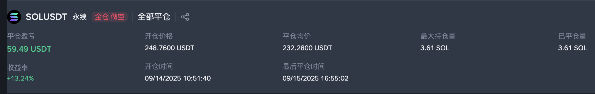
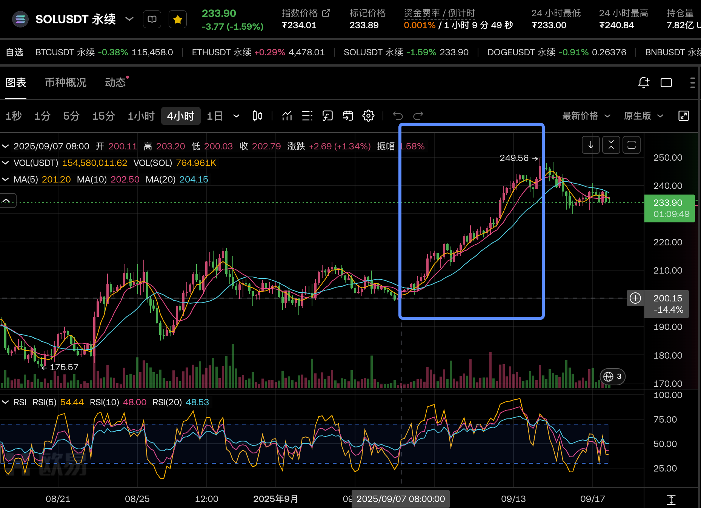

2025-09-15 周一
## 1. 近期是否有大事？
9月18日凌晨美联储降息
## 2. 美股情况如何？
## 3. 记录行情
大环境，临近降息 + BTC触底反弹，带动大盘拉升，DOGE和SOL开启一次单边行情。
在这个过程中，做空3单都挨揍了，最后一单接到顶针吃满一次回调回本。

从4h线看，SOL从200到250之间，4h线进入金叉状态之后就没有死叉过。持续了一周的单边上涨。

## 4. 总结